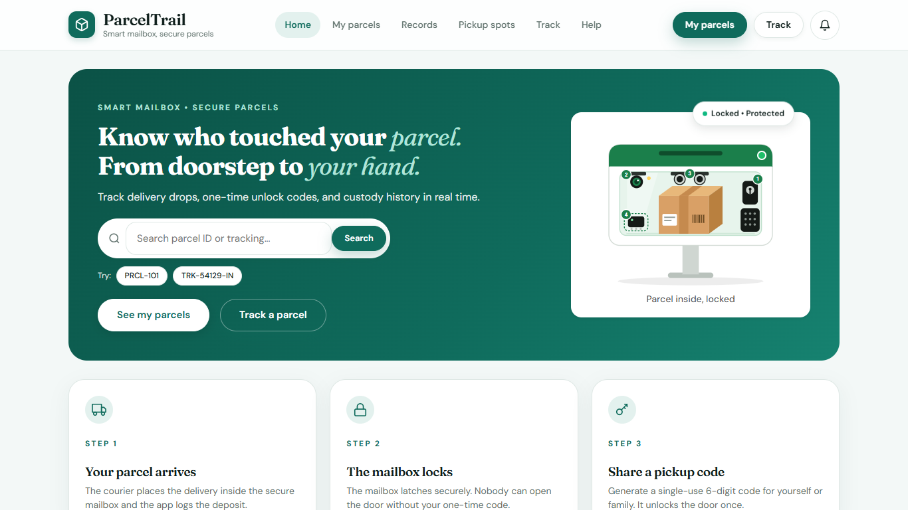
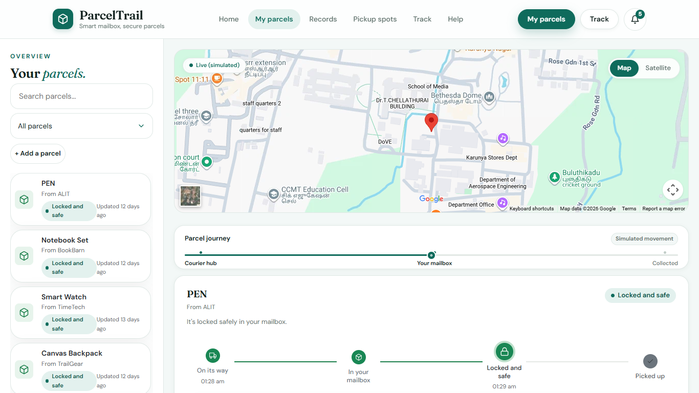
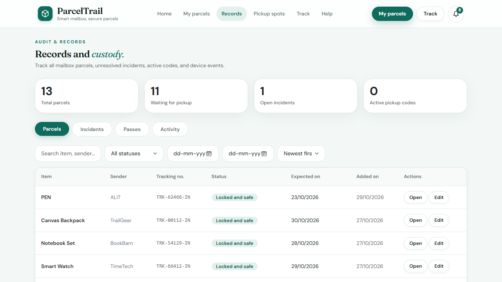
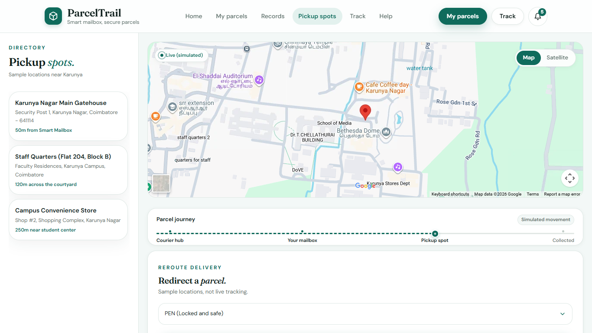
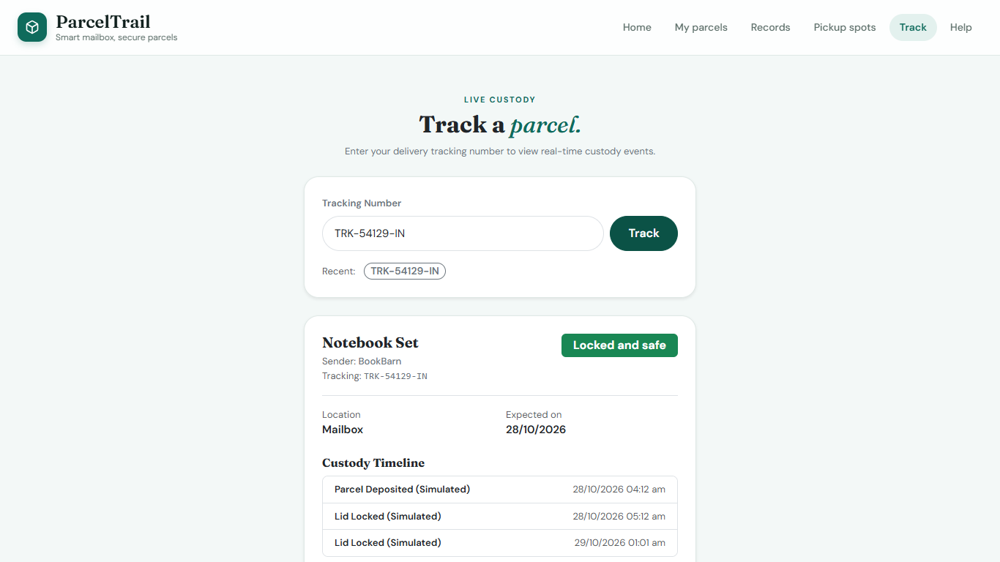
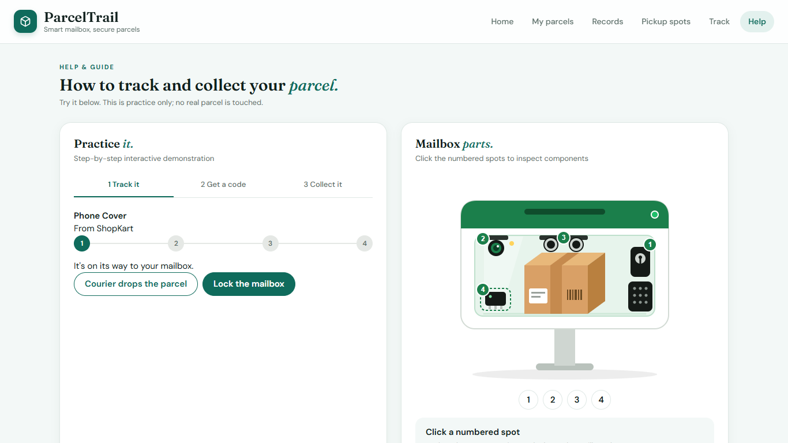

# ParcelTrail — Smart Mailbox & Parcel Custody Web Application

> *"Know who touched your parcel, from doorstep to your hand."*

**Live Website:** [https://parcel-trail.vercel.app/](https://parcel-trail.vercel.app/)

**Architecture:** Full-Stack MERN (`React + Vite` Frontend · `Node.js + Express` REST API · `MongoDB + Mongoose`)

---

## 1. Project Overview

ParcelTrail is a full-stack web application that simulates an IoT-enabled smart mailbox and maintains a tamper-evident custody diary for household deliveries. It addresses single-user mailbox vulnerabilities by providing temporary delegated collection codes, wrong-try lockdown protection, simulated hardware telemetry, pickup-spot redirection, incident management, and public parcel tracking.

### Architectural & Simulation Scope
- **Single Resident Model (No Login Required):** Designed intentionally without user accounts, registration, or login flows. A single resident dashboard manages incoming parcels and issues temporary 6-digit codes when someone else needs to collect a parcel on the resident's behalf.
- **Software-Simulated Hardware Sensors:** All physical hardware events (ultrasonic parcel detection, servo/relay/solenoid latch, ESP32-CAM snapshot and flash LED, accelerometer tamper shake, and audible alert) are simulated in software and labeled clearly as `Simulated`.
- **Real Database Persistence:** The frontend communicates with an Express REST API backed by MongoDB (`Parcel`, `PickupPoint`, and `Mailbox` Mongoose models).

---

## 2. Key Features

- **Parcel Management (`My parcels`):** Add expected deliveries, search by item/sender/tracking ID, filter by status, trigger lifecycle actions, view live custody progress, and delete completed (`Collected`) records.
- **Smart Mailbox Simulation:** Simulate courier deposit (`Expected -> Deposited`), lid locking (`Deposited -> Locked`), optical snapshots (`/photo`), flash LED toggling (`/flash`), and accelerometer tamper alerts (`Tamper Alert` with audio siren playback).
- **6-Digit One-Time Pickup Pass:** Generate time-limited collector passcodes with a live countdown timer, single-use enforcement, and expiry validation.
- **3-Attempt Security Lockout:** Entering an incorrect 6-digit code decrements remaining tries in MongoDB (`$inc`); 3 failed tries automatically lock the pass and raise a `Tamper Alert`.
- **Custody History & Audit Trail:** Chronological timeline and tabular custody event logs on each parcel plus a paginated global activity log.
- **Management Dashboard (`Records`):** Overview counters (`Total`, `Waiting`, `Open incidents`, `Active codes`), sortable/paginated parcels table with inline edits and CSV export, incident resolution workflow, and active pass cancellation.
- **Pickup Spot Redirection (`Pickup spots`):** Embedded Google Maps directory (Road Map / Satellite toggle) to reroute eligible deliveries to verified neighborhood pickup points.
- **Public Tracking (`Track`):** Standalone Vanilla JavaScript + `localStorage` recent-search lookup page (`/track.html`) supporting direct URL queries (`?tracking=TRK-54129-IN`).
- **Interactive Help Guide (`Help`):** Standalone jQuery 3-step practice simulator (including 3-attempt lockout demo) and interactive mailbox component hotspots (`/help.html`).

---

## 3. Screenshots

| Home & Quick Search | My Parcels Dashboard |
|---|---|
|  |  |

| Audit & Records Dashboard | Pickup Spots Redirection |
|---|---|
|  |  |

| Public Tracking Lookup | Interactive Help & Practice |
|---|---|
|  |  |

---

## 4. Technology Stack

- **Frontend:** React 18, React Router v6, Vite 5, Bootstrap 5, custom CSS design system, Vanilla JS + `localStorage` (`track.html`), jQuery (`help.html`)
- **Backend:** Node.js 20, Express 4, Mongoose 8, `cors`, `dotenv`
- **Database:** MongoDB (MongoDB Atlas or local MongoDB Community Server)
- **Testing & QA:** Node.js native assertions (backend rules & utilities unit suite, API integration suite, frontend helper unit suite), `playwright-core` (Microsoft Edge E2E suite), Postman Collection v2.1
- **CI / Hosting:** GitHub Actions (`.github/workflows/ci.yml`), Vercel (`client/`), Render (`server/`), MongoDB Atlas

---

## 5. Architecture & Project Structure

```text
Browser (React SPA + track.html + help.html)
   │
   │  API calls via VITE_API_BASE_URL (default: /api)
   ├─► Development: Vite dev proxy -> VITE_PROXY_TARGET (http://localhost:5000)
   └─► Production (Vercel): client/vercel.json rewrite -> Render API
   ▼
Express Server (server/server.js)
   ├── CORS (CORS_ORIGIN allowlist) + express.json() + activityLogger
   ├── Routes: parcelRoutes, parcelActionRoutes, recordsRoutes,
   │           recordsDetailRoutes, trackRoutes, otherRoutes
   ├── Business Rules & Helpers: parcelRules, passRules, parcelQuery, passState, events
   └── Mongoose ODM (server/db.js -> parcelTrail | test: parceltrail_test)
          ▼
     MongoDB (parcels, pickuppoints, mailboxes collections)
```

```text
ParcelTrail/
├── .github/workflows/ci.yml            # GitHub Actions CI pipeline
├── .env.example                        # Full environment variable reference
├── .gitignore
├── package.json                        # Root workspace convenience scripts
├── scripts/
│   ├── check-syntax.js                 # Cross-platform Node syntax checker
│   └── dev.js                          # Runs server & client dev servers concurrently
├── docs/screenshots/                   # UI screenshots embedded in README
├── postman/
│   └── ParcelTrail.postman_collection.json
├── client/
│   ├── .env.example                    # Frontend env template
│   ├── vercel.json                     # Vercel API proxy & SPA fallback rewrites
│   ├── vite.config.js                  # Vite dev server & /api proxy config
│   ├── index.html                      # React entry HTML
│   ├── public/
│   │   ├── track.html                  # Standalone Vanilla JS tracking page
│   │   ├── help.html                   # Standalone jQuery help & practice page
│   │   ├── assets/                     # SVGs, favicon, simulated alert WAV audio
│   │   ├── css/ & js/                  # Static stylesheets, track.js, help-practice.js
│   ├── src/
│   │   ├── pages/                      # HomePage, MyParcelsPage, RecordsPage, PickupPointsPage
│   │   ├── components/                 # Sidebar, Summary, Pickup, Options, History, Records tabs
│   │   └── utils/                      # api.js, recordsApi.js, labels.js, locations.js, csv.js
│   └── tests/
│       ├── test-ui-helpers.js          # Frontend utility unit tests
│       └── e2e.js                      # Playwright Edge E2E suite
└── server/
    ├── .env.example                    # Backend env template
    ├── server.js                       # Express app & DB bootstrap
    ├── db.js                           # dotenv loader, URI resolver, test DB isolation
    ├── seed.js                         # Dynamic 12-parcel & 3-pickup-point seeder
    ├── models/                         # Parcel.js, PickupPoint.js, Mailbox.js
    ├── routes/                         # Express API route modules
    ├── rules/                          # parcelRules.js, passRules.js
    ├── utils/                          # parcelQuery.js, passState.js, events.js, findParcel.js, corsOptions.js
    ├── middleware/                     # activityLogger.js, errorHandler.js
    ├── demo/ & tools/                  # CLI inspection & syllabus demos
    └── tests/                          # Unit tests + MongoDB integration tests
```

---

## 6. Getting Started (Local Development)

### Prerequisites
- **Node.js** `>= 18` (Node 20 recommended) and **npm**
- **MongoDB** database connection: either a free [MongoDB Atlas](https://www.mongodb.com/atlas) cluster or a local MongoDB instance (`mongodb://127.0.0.1:27017`)

### Step 1: Clone the Repository
```bash
git clone https://github.com/EUNICEMERCY123/ParcelTrail.git
cd ParcelTrail
```

### Step 2: Install Dependencies
Install backend and frontend dependencies separately:
```bash
npm --prefix server install
npm --prefix client install
```
Or install both using the root helper script:
```bash
npm run install:all
```

### Step 3: Configure Environment Variables

Copy the backend environment template:
```bash
# macOS / Linux
cp server/.env.example server/.env

# Windows (PowerShell)
Copy-Item server/.env.example server/.env
```
Then edit `server/.env` with your MongoDB connection string (never commit `.env` files to Git). Optionally copy `client/.env.example` to `client/.env` if you want to customize the frontend API base URL or Vite proxy target.

#### Environment Variables Reference

**Backend (`server/.env`)**

| Variable | Required | Default | Description |
|---|---|---|---|
| `MONGODB_URI` | Yes (recommended) | `mongodb://127.0.0.1:27017/parcelTrail` | MongoDB Atlas or local connection string for the main database. |
| `MONGODB_TEST_URI` | For DB integration tests | Rewrites `MONGODB_URI` DB to `parceltrail_test` | Dedicated test database URI used automatically when `NODE_ENV=test`. |
| `PORT` | No | `5000` | Express HTTP server listening port. |
| `CORS_ORIGIN` | No | `http://localhost:3000,http://127.0.0.1:3000,https://parcel-trail.vercel.app` | Comma-separated allowed browser origins (`*` allows any origin). |

**Frontend (`client/.env` — optional)**

| Variable | Required | Default | Description |
|---|---|---|---|
| `VITE_API_BASE_URL` | No | `/api` | Base URL used by frontend fetch calls. Keep `/api` to use Vite dev proxy (local) or `client/vercel.json` (production). |
| `VITE_PROXY_TARGET` | No | `http://localhost:5000` | Target backend URL used by Vite's `/api` dev proxy. |

### Step 4: Database Setup & Seeding

1. **MongoDB Atlas (Recommended):**
   - Create a free M0 cluster on [MongoDB Atlas](https://www.mongodb.com/atlas).
   - Under **Database Access**, create a user with read/write permissions.
   - Under **Network Access**, allow your IP address (or `0.0.0.0/0` for cloud hosting like Render).
   - Paste the connection string into `server/.env` as `MONGODB_URI=mongodb+srv://<USER>:<PASSWORD>@<CLUSTER>.mongodb.net/parcelTrail?retryWrites=true&w=majority`.
2. **Local MongoDB:** Ensure `mongod` is running locally on port `27017`.
3. **Seed Demo Data (Optional):**
   ```bash
   npm run seed
   # Or inspect seeded documents:
   npm run show-data
   ```
   *(You can also click **Reset demo data** inside the `My parcels` sidebar in the UI.)*

### Step 5: Run the Application Locally

Start backend and frontend in two separate terminals:
```bash
# Terminal 1 — Backend API (http://localhost:5000)
npm --prefix server run dev

# Terminal 2 — Frontend Vite Dev Server (http://localhost:3000)
npm --prefix client run dev
```
Or run both concurrently from the repository root:
```bash
npm run dev
```
Open **[http://localhost:3000/](http://localhost:3000/)** in your browser. Vite automatically proxies `/api/*` requests to `http://localhost:5000`.

### Build for Production
```bash
npm --prefix client run build
npm --prefix client run preview
```

---

## 7. Automated Testing & Verification

### DB-Free Checks (Safe Anytime, Run in CI)
```bash
# Syntax verification across server, scripts, static JS, and E2E scripts
npm run lint:syntax

# Backend business rules + utility unit tests (28 assertions, no DB needed)
npm --prefix server run test:unit

# Frontend UI helper unit tests (13 assertions, no DB needed)
npm --prefix client test

# Run both unit test suites together from root
npm test
```

### Database Integration & Browser E2E Tests
> **Database Safety:** Integration tests (`server/tests/test-api.js`, `test-records-api.js`, `test-track-api.js`) set `NODE_ENV=test`, which connects exclusively to `MONGODB_TEST_URI` or automatically switches the database path of `MONGODB_URI` to `parceltrail_test` so your primary `parcelTrail` database is never overwritten.
>
> For `npm run test:e2e`, start the backend against a **test/local database** because `e2e.js` calls `POST /api/parcels/reset` during setup.

```bash
# Backend API integration tests (uses parceltrail_test)
npm --prefix server run test:integration

# Full backend test suite (unit + integration)
npm --prefix server test

# Browser E2E tests with Microsoft Edge (requires running client & test backend)
npm run test:e2e
```

### Additional CLI Tools
```bash
node server/demo/node-basics-demo.js       # Node.js event loop, fs, http demo (no DB required)
node server/demo/mongoose-queries-demo.js  # Mongoose CRUD demo against parcelTrailDemo sandbox DB
```

---

## 8. API Endpoints Reference

| Method | Endpoint | Description |
|---|---|---|
| `GET` | `/api/health` | Server & MongoDB connection health status |
| `GET` | `/api/parcels` | List parcels (`?search=`, `?status=Expected,Deposited`, `$slice` event projection) |
| `POST` | `/api/parcels` | Create an expected parcel (`itemDescription`, `sender`, optional `trackingNumber`, `expectedDate`) |
| `POST` | `/api/parcels/reset` | Reset & reseed the database with the 12 demo parcels and 3 pickup points |
| `GET` | `/api/parcels/:id` | Get full parcel document by `parcelId` or Mongo `_id` |
| `PUT` | `/api/parcels/:id` | Update parcel metadata (blocked once `Collected`) |
| `DELETE` | `/api/parcels/:id` | Delete a `Collected` parcel record |
| `POST` | `/api/parcels/:id/simulate` | Simulate sensor event (`{"eventType": "drop"}`, `"lock"`, `"snapshot"`, or `"tamper"`) |
| `POST` | `/api/parcels/:id/pass/issue` | Issue temporary 6-digit pickup pass (`{"collectorName", "expiryMinutes"}`; alias `POST /pass`) |
| `POST` | `/api/parcels/:id/pass/verify` | Verify 6-digit passcode on keypad (`{"inputCode"}`; 3-try lockout) |
| `POST` | `/api/parcels/:id/pass/cancel` | Cancel active unused pickup pass (alias `DELETE /api/parcels/:id/pass`) |
| `POST` | `/api/parcels/:id/redirect` | Redirect parcel to a pickup spot (`{"locationName", "address"}` or `{"pickupPointId"}`) |
| `POST` | `/api/parcels/:id/report` | File an incident report (`type`, `description` >= 10 chars) |
| `GET` | `/api/passes/active` | Count currently active, non-expired pickup passes (`$gt`) |
| `GET` | `/api/records/stats` | Summary metrics for Records dashboard cards |
| `GET` | `/api/records/parcels` | Paginated parcels table (`?page=`, `?limit=`, `?sort=`, `?search=`, `?status=`, `?from=`, `?to=`) |
| `GET` | `/api/records/incidents` | List incident reports with `?status=` and `?type=` filters |
| `POST` | `/api/records/incidents/:parcelId/:reportId/resolve` | Mark an incident resolved with a note (alias `POST /api/records/resolve`) |
| `GET` | `/api/records/passes` | Pickup pass lifecycle list (`?state=active`, `used`, `expired`, or `locked`) |
| `GET` | `/api/records/activity` | Paginated custody event audit trail (`?parcelId=`, `?type=`, `?page=`, `?limit=`) |
| `GET` | `/api/track/:trackingNumber` | Public lookup by tracking number or parcel ID (case-insensitive) |
| `GET` | `/api/pickup-points` | List configured pickup spot directory |
| `GET` | `/api/mailbox/flash` | Get current simulated camera flash LED state |
| `POST` | `/api/mailbox/flash/toggle` | Toggle simulated camera flash LED state (alias `POST /api/mailbox/flash`) |
| `GET` | `/api/notifications` | Return 5 most recent custody events across parcels |

### Postman Collection
Import [postman/ParcelTrail.postman_collection.json](postman/ParcelTrail.postman_collection.json) (Collection v2.1) into Postman. All routes, bodies, status tests (`200`/`201`), and collection variables (`baseUrl`, `parcelId`, `collectedParcelId`, `incidentParcelId`, `reportId`) align with the backend API.

---

## 9. Continuous Integration & Deployment

### GitHub Actions CI
The workflow in [.github/workflows/ci.yml](.github/workflows/ci.yml) runs automatically on every `push` and `pull_request` to `main`:
1. Installs backend (`server/`) and frontend (`client/`) dependencies cleanly (`npm ci`).
2. Checks JavaScript syntax across backend routes, scripts, static JS, and E2E tests (`npm run lint:syntax`).
3. Verifies all server models, middleware, rules, utilities, and Express route modules load cleanly.
4. Runs all DB-free backend (`28` assertions) and frontend (`13` assertions) unit tests.
5. Builds the Vite production bundle (`npm --prefix client run build`) and validates build output plus Postman JSON syntax.

### Cloud Deployment (Render + Vercel + MongoDB Atlas)
1. **Database:** Configure MongoDB Atlas and copy your `MONGODB_URI`.
2. **Backend (Render Web Service):**
   - Root Directory: `server`
   - Build Command: `npm install`
   - Start Command: `npm start`
   - Environment Variables: `MONGODB_URI`, optional `CORS_ORIGIN` (defaults include `https://parcel-trail.vercel.app`)
3. **Frontend (Vercel):**
   - Root Directory: `client`
   - Framework Preset: `Vite` (`npm run build` -> `dist`)
   - API Rewrite: Configured in [client/vercel.json](client/vercel.json) to forward `/api/:path*` to `https://parceltrail-api.onrender.com/api/:path*` and fall back client-side routes to `/index.html`.

> **Render Note:** Free Render instances spin down after ~15 minutes of inactivity, so the first API request after idle time may take a few seconds to wake up.
